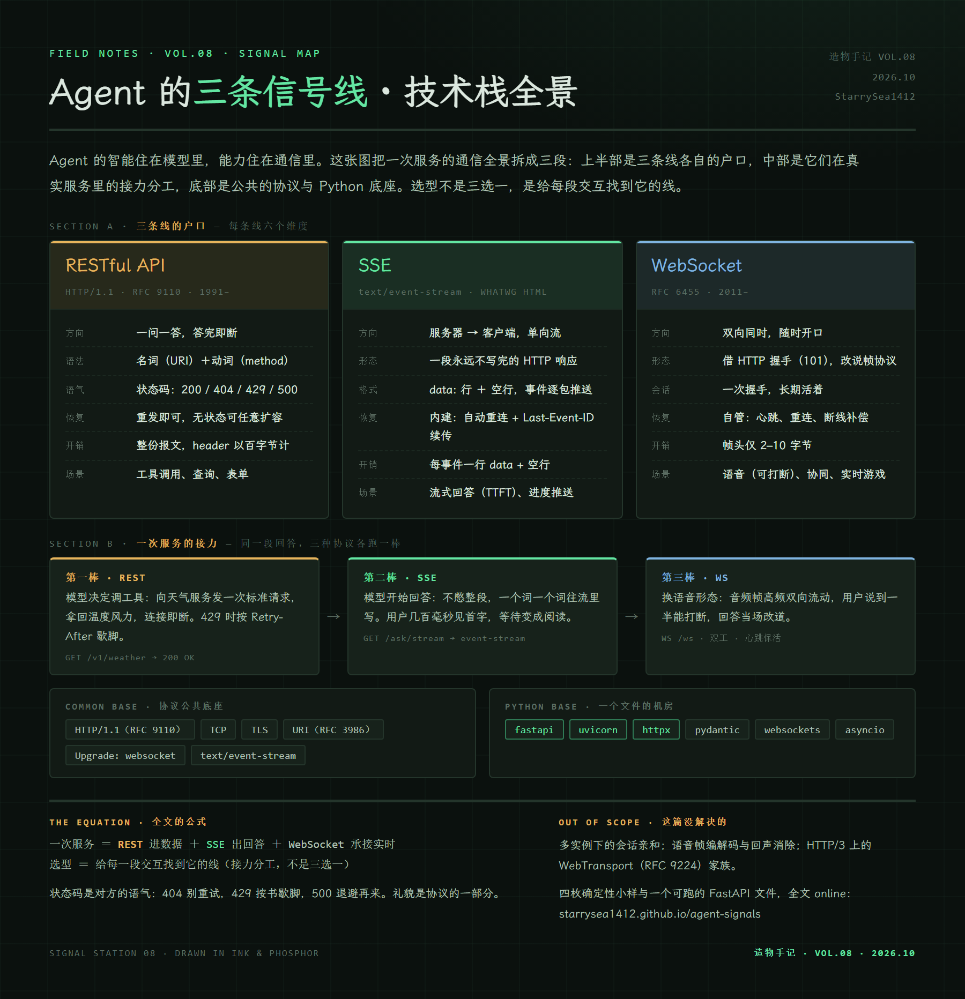

# Agent 的三条信号线 · 造物手记 VOL.08

> 从一行招聘要求出发：Python 是 Agent 的母语，REST、SSE、WebSocket 是它和世界说话的三种方式。

**[打开这一页 →](https://starrysea1412.github.io/agent-signals/)**



一行 AI 岗的 JD 写着：「熟练掌握 Python 技术（必需），熟悉基本语法和常用库，熟悉 SSE，WebSocket 和 Restful Api 通信方法」。这篇把它拆到底：**模型是 Agent 的脑子，通信是 Agent 的嘴和耳朵**。全程只用一个查天气的小 Agent「小晴」，让同一条消息在三条协议里各走一遍完整的一生——逐字节看报文，逐毫秒看时序，最后把三种端点装进同一个 FastAPI 文件。

## 七章

| # | 章节 | 讲什么 |
|---|---|---|
| 01 | 一行 JD 的分量 | 为什么 AI 岗不先问模型先问通信；Python 的生态重力；一次服务的三棒接力 |
| 02 | RESTful API：Agent 的普通话 | 名词＋动词＋状态码；工具调用即 HTTP 请求；429 的 Retry-After 是可靠性工程的黄金 20 字符 |
| 03 | SSE：流式输出的血管 | 打字机效果＝一段永远不写完的 HTTP 响应；TTFT 首字延迟的经济学；EventSource 只发 GET 的坑 |
| 04 | WebSocket：全双工的电话 | 借 HTTP 的门（101 握手）进 TCP 的屋；barge-in 打断；心跳、断线与补偿的账单 |
| 05 | 选型法庭 | 三协议六维度对照表＋六道场景题当场判分；高级答案是接力分工不是三选一 |
| 06 | 一个文件，三种端点 | FastAPI 同时挂 /v1/weather（REST）＋/ask/stream（SSE）＋/ws（WS），Python 常用库清单 |
| 07 | 从 JD 到作品 | 三件五分钟能演示的事；一条一周路径；「背过」和「干过」的分界 |

## 四枚可玩小样

全部是**确定性模型**，不是录屏：参数可调、行为可复现，无随机数。

- **报文解剖台**：GET/POST 两场景 × 200/404/429/500 四种语气，整份 HTTP 报文逐行注解，点行看职务
- **首字竞速台**：同一回答非流式 vs SSE 双赛道，生成速度/RTT/长度三滑杆，TTFT 数字与 SSE 事件流原文同屏——拖大「回答长度」看流式的首字几乎不动
- **双工对讲机**：同一段对话半双工 vs 全双工时间线，插话排队 vs 一帧送达，可开心跳与模拟断线（断线期间的帧不补发）
- **选型法庭**：六道场景题，最优 2 分/可行 1 分/答错 0 分，判决附真实世界参照物

## 本地构建

```bash
node build/build.mjs          # 拼接单文件 index.html（多文件源在 build/）
node build/render-stack.mjs   # docs/tech-stack.html → assets/tech-stack.png（需本机 playwright）
node build/verify.mjs         # 无头验收：逐小样状态截图 + 报错收集 + 移动端溢出（→ shots/）
```

字体：LXGW 文楷子集（OFL 许可，见 `assets/fonts/OFL.txt`），字符清单在 `build/chars.txt`。

---

造物手记系列：[VOL.07 把能力打包成技能](https://starrysea1412.github.io/agent-skillcraft/) · [VOL.06 给 Agent 打分](https://starrysea1412.github.io/agent-eval/) · [VOL.05 让 Agent 亲眼看一眼](https://starrysea1412.github.io/seeflow-story/) · [VOL.04 Agent 内核](https://starrysea1412.github.io/agent-kernel/)
